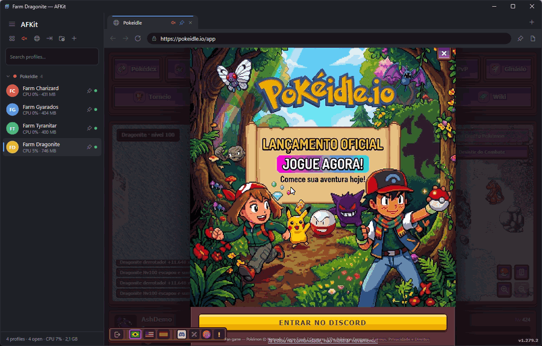
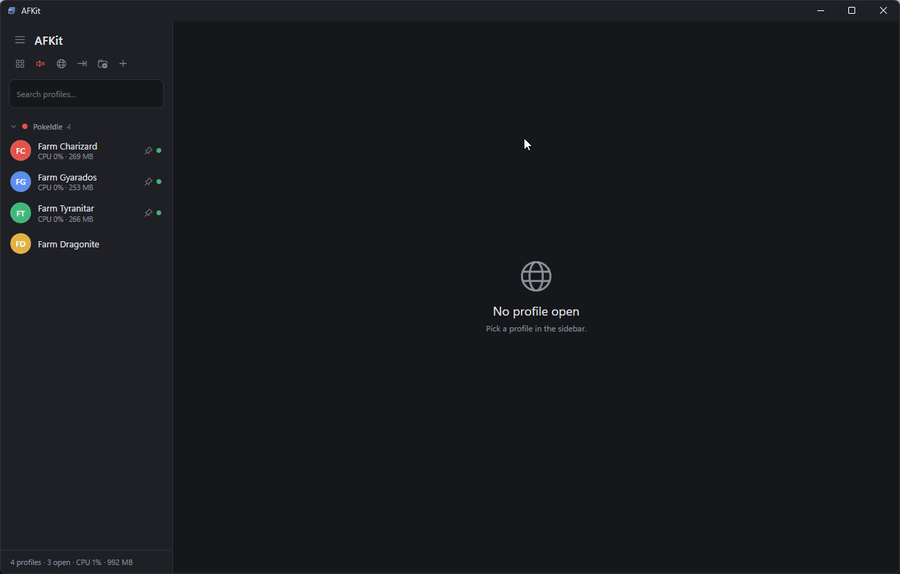
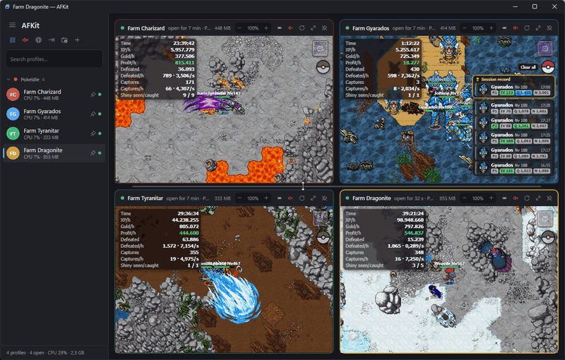
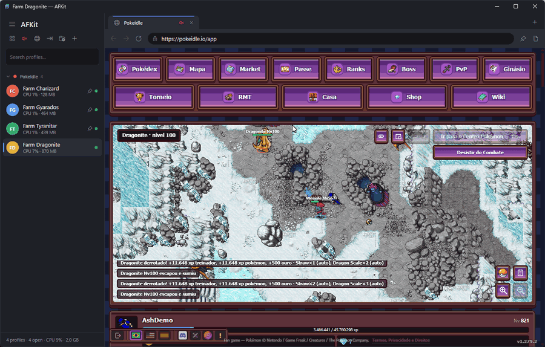
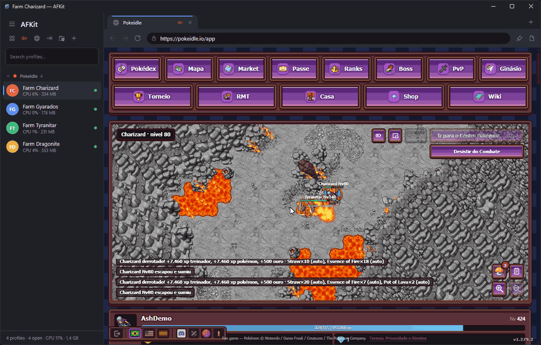
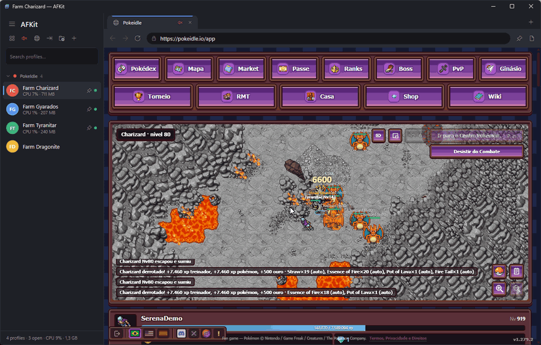
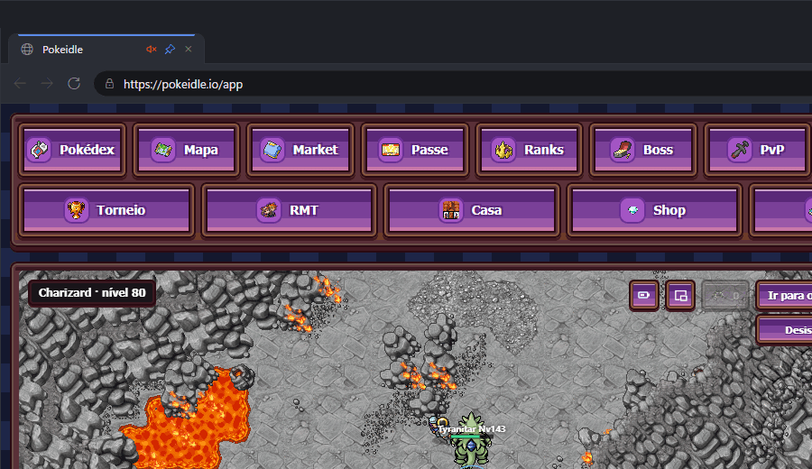

# AFKit 

**Run more. Stay AFK.** — The multi-account browser for idle games.

A browser profile manager for Windows. Each profile runs **inside the app**, with its cookies, logins, history and cache completely isolated from the other profiles.



Built with C# / .NET 8 / WPF + Microsoft Edge WebView2. Available in **English, Português (Brasil) and Español**.

## Language

The interface speaks three languages. It starts in your Windows language (English if yours is not one of the three) and you can switch any time:

- **Sidebar:** the globe button next to the import button.
- **Tray icon menu:** *Language*.

Changing the language restarts AFKit (open sessions are saved and restored) so every text is rebuilt in the new language. The choice is saved in `afkit.json`.

## New in V2 — Task bar (battle window)

Each profile that is turned on gets **its own floating mini window**, independent and with a transparent background (position, size and Overlay of each one), which shows **your Pokémon in play and the Pokémon it is facing** in PokeIdle, in the look of the **Game Boy Advance battle screens**: the enemy at the top right, front view, on a green platform, with its box at the top left (name, level and HP bar); your Pokémon at the bottom left, back view, on its platform, with your box at the bottom right (name, level, HP bar, the HP numbers and the blue EXP bar). The boxes are cream with a dark border, in a pixel font (Press Start 2P, OFL license); the HP bar is green above 50%, yellow down to 20% and red below that; shiny gets a golden ★. The sprites come from the game's own sheet, with the 3 movement frames (shiny version when the game has one), and on every hit of your Pokémon the animation of that move's type (DARK, ICE…) shows over the enemy.



- **Turn it on per profile:** right-click the profile → *Show in task bar*.
- **Turn the windows on / all profiles:** tray icon menu → *Task bar (battle window)*, *show all profiles* or *remove all profiles*.
- **One window per profile:** each one moves, resizes and has its Overlay **independent** of the others. Drag with the left button, resize from the bottom-right corner; right button → *Overlay (always on top)* (starts on in every new window) or *Hide the window* (turns them all off). Position, size and Overlay are saved per profile.
- **First time:** new windows show up in the bottom-right corner, stacked upward without overlapping (when there is no more room, they start another column to the left).
- **Opens and closes by itself:** the profile's window shows up when the session is open with PokeIdle in a tab, and closes when the profile is removed from the task bar, the session is closed or the game tab goes away.
- **Which tab:** the tab pinned in the profile's grid; with no pinned tab, the first tab with PokeIdle.
- **Out of combat:** only your Pokémon (standing still, back view), the platform and your box.
- **How it works:** an AFKit script runs only on pokeidle.io and only **reads**: the "Em campo" (in play) panel (your Pokémon) and the `campo`/`batalha` messages the server already sends to the page (enemy). It does not click, send anything to the server or change the game. Tabs that were already open before an update need to be reloaded once.

## New in V2 — Grid with immersive mode and watermarks

- **Automatic immersive mode:** when you enter grid mode (Ctrl+G), each cell with PokeIdle turns on the game's own *Immersive Mode* (just the battle, no panels). On leaving the grid, it is turned off. If you click the game's *Exit immersive mode* button in a cell, AFKit respects it: that cell stays without immersive until you leave the grid and come back.
- **Session watermark (top-left corner):** Time, XP/h (trainer), Gold/h and Profit/h, very transparent. Hover over it to see the game's full Session panel.
- **Captures watermark (top-right corner):** the 5 most recent captures with thumbnail, level, potential and Grade; the P5s go on top with a golden border, and the rest follow by Grade.
- **Clicks go through** the watermarks (only the session summary reacts to the mouse, for the hover).
- **How it works:** the script only acts on pokeidle.io. So the game keeps updating the numbers, it keeps the Session panel open (invisible in immersive) and opens the Captures one for a moment when a new capture arrives. On leaving the grid, the panels go back as they were.

## Task bar: session and captures

The battle window gained a strip at the bottom with the session summary (Time, XP/h, Gold/h, Profit/h), the session record and the 5 latest captures, the same as the grid. Outside the grid, AFKit only opens the game's panels (needed for Profit/h, Grade and portraits) while the tab is not on screen; when the tab is opened, they close.

## Grid: colors and swapping places

- **Border in the profile's color:** each grid cell uses the profile's color in its frame (stronger and thicker on the focused cell).
- **Swap windows:** drag a cell's header (the profile name) onto another cell; the target cell gets a white border and, on release, the two swap places. Esc cancels. The order is saved.



## Twitch and Kick lives reopen as they were

When a session is closed, AFKit saves each live's player sound (muted or not, and volume) and quality (e.g. 160p), plus the tab's own mute. On reopening everything comes back the same: you can, for example, leave the player unmuted at 160p with the tab muted in AFKit. Nothing is fixed; the last state of each tab wins. Muted tabs are born silent, and AFKit's browser lets lives start playing on their own with the player's sound on.

**Muting:** unmuting a tab while the profile is muted (or with "Mute everything") gives the sound back only to that tab; the others stay muted.

## Features

- **Isolated profiles** — each profile has its own Chromium data folder (`%LOCALAPPDATA%\AFKit\Profiles\{id}`). You can be logged in to 10 accounts of the same site at the same time.

  
- **Multiple tabs per profile** — `window.open`/`target=_blank`/login popups open as a new tab in the same profile. Tabs are restored when the profile is reopened. Drag a tab sideways to change the order (like Chrome; Esc cancels), or use the tab menu → *Move left/right* and Ctrl+Shift+PageUp/PageDown. The order is saved.
- **Groups, colors and icons** — organize profiles in collapsible groups; each profile has a color and an icon (emoji or initials).
- **Grid mode** — pick one tab of each profile (right-click the tab → *Pin this tab to the grid*, or the pin next to the address bar) and see up to 4 side by side (1 = full screen, 2 = side by side, 3 = 2+1, 4 = 2×2). The other tabs and profiles keep running.

  
- **Resizable grid with zoom** — each cell is a card with status (● green = all good, orange = recovering), open time and memory. Drag the dividers between cells to resize (double click goes back to an even split); the size is saved. Per-page zoom with the − 100% + buttons in the header, Ctrl + mouse wheel or Ctrl +/−/0 — also saved.
- **Mute tab** — click the tab's speaker, use the tab menu or Ctrl+M (in the grid, the button in the cell header). You can also mute the whole profile (right-click the profile → *Mute profile*, or Ctrl+Shift+M), including new tabs. Everything stays muted on reopening.
- **CPU and memory per profile** — under each open profile's name (orange above 25% CPU or 1.5 GB); AFKit's total is in the footer and in the tray icon tooltip.
- **Mute everything** — speaker button at the top of the sidebar, Ctrl+Alt+M or from the tray menu. Combines with tab and profile muting.
- **System tray** — the X sends AFKit near the clock without pausing anything (the window leaves the screen, but stays "visible" to Chromium). Click the icon to come back; "Exit AFKit" in the menu really closes it. You can turn this off in the same menu. Opening AFKit again from the shortcut brings the window that is already running.
- **Automatic recovery** (on by default) — AFKit notices a hung or crashed page, a dropped connection, a site that is down (5xx errors or no response) and missing internet, and reloads by itself. It retries with growing waits (5 s, 15 s, 30 s, 1, 2 and 5 min) so it does not hammer the site; with no internet, it waits for the connection and reloads right away. Meanwhile the tab shows an orange ⚠ with the reason. If the profile's whole browser crashes, the session is reopened. Toggle it in the tab or tray menu.
- **Reload every X minutes** — right-click the tab → *Reload automatically* (1, 5, 10, 15, 30 or 60 min). Tabs with this on show the ⟳ icon.
- **Collapsible sidebar** — the ☰ button at the top of the bar (or Ctrl+B) hides the menu, leaving only a narrow strip with the avatars (green dot = session open, blue bar = active profile); click ☰ again to show it. Click, right-click and drag keep working on the strip. The bar pushes the page instead of floating over it, and the choice is saved.
- **Reorder profiles** — drag in the sidebar (even to another group; dropping on the group name puts it at the top) or use *Move up/down* in the profile menu.
- **Look** — full dark theme (title bar, menus, fields, scroll bars), browser-style tabs with a highlight and loading indicator, and its own icon.
- **Extensions per profile** — right-click the profile → *Extensions…*. Paste the Chrome Web Store link (or just the 32-letter ID) and click *Install*: AFKit downloads and installs it by itself. You can also install from a `.crx`/`.zip` file or an unpacked folder (with `manifest.json`). Each profile has its own: enable/disable, open the extension's *Options* in a tab and remove. Works with the session open (applies right away and reloads the tabs so the extension's scripts get into the pages) or closed (applies when the profile opens).

  
- **Backup** — exports/imports a profile as `.afkitprofile` (a zip with metadata + browser data, without caches). Old `.deckprofile` backups can still be imported.
- **Background mode per tab** — right-click the tab → *In the background*: **Light** (default: off screen the tab is not drawn, not even video, but scripts and timers keep running), **Active** (keeps drawing, ⚡ icon) or **Suspended** (freezes until you open it, 🌙 icon). Tabs off screen also ask the browser to use less memory. Green indicator = session open; "Close session" frees everything.

  

## Requirements

- Windows 10 or 11
- [.NET 8 SDK](https://dotnet.microsoft.com/download/dotnet/8.0) (to build)
- WebView2 Runtime (already in Windows 11 and most Windows 10; the app warns if it is missing)

## Install / update

**Double-click `Install AFKit.cmd`** (in the project folder). It builds, installs to `%LOCALAPPDATA%\Programs\AFKit`, creates the Start Menu and desktop shortcuts and opens the app. To update, extract the new version over the old one and run the same file; profiles and logins are not affected.

Coming from **Deck** (the app's old name)? The installer removes the old install and shortcuts, and AFKit moves your data from `%LOCALAPPDATA%\Deck` to `%LOCALAPPDATA%\AFKit` the first time it runs — profiles, logins and extensions come along.

To develop: `dotnet run --project src\AFKit`, or open `AFKit.sln` in Visual Studio 2022. Set the `AFKIT_DATA_DIR` environment variable to keep a run's data in another folder (portable use, tests).

## Shortcuts

| Shortcut | Action |
|---|---|
| Ctrl+Shift+N | New profile |
| Ctrl+G | Turn grid mode on/off |
| Ctrl+B | Show / hide the side menu |
| Ctrl+1 … Ctrl+9 | Switch profile (sidebar order) |
| Ctrl+M | Mute / unmute the tab |
| Ctrl+Shift+M | Mute / unmute the whole profile |
| Ctrl+Alt+M | Mute / unmute everything |
| Ctrl + / Ctrl − / Ctrl 0 | Page zoom (also Ctrl + mouse wheel) |
| Ctrl+T / Ctrl+W | New tab / close tab |
| Ctrl+Tab / Ctrl+Shift+Tab | Next / previous tab |
| Ctrl+Shift+PageUp / Ctrl+Shift+PageDown | Move the tab left / right |
| Ctrl+L | Address bar |
| F5 / Ctrl+R | Reload |
| Alt+← / Alt+→ | Back / forward |
| F12 | DevTools |
| Middle click on a tab | Close tab |
| Drag a tab | Reorder tabs (Esc cancels) |

## Where the data lives

```
%LOCALAPPDATA%\AFKit\
  afkit.json           ← profiles, groups, saved tabs, language
  Profiles\{id}\       ← each profile's browser data
  Extensions\{id}\{version}\  ← unpacked extensions (shared between profiles)
```

## Known limitations

- Isolation is of data (cookies, storage, cache), not of fingerprint: all profiles share the same user agent and machine characteristics.
- Extensions: there is no toolbar button or popup (extensions that only work through the toolbar icon cannot be used); the options page opens as a tab; some Chrome APIs do not exist in WebView2, so not every extension works; the store's own "Add to Chrome" button does not work inside AFKit — use the *Extensions…* dialog with the link. Extensions that only touch pages (content scripts) work well.
- Extensions stay unpacked in `%LOCALAPPDATA%\AFKit\Extensions`; when importing a backup on another machine, install them again if they show up as "not loaded".

## Structure

See [ARCHITECTURE.md](ARCHITECTURE.md) for how AFKit is built inside (architecture, data flow, persistence, injected scripts and how to add a language).

```
src/AFKit/
  App.xaml(.cs)               theme, WebView2 Runtime check, language startup
  MainWindow.xaml(.cs)        sidebar, groups, session lifecycle, backup
  Controls/ProfileView        a profile's session: WebView2 environment + tabs + navigation bar
  Controls/BrowserTab         a tab's state
  Dialogs/                    profile editor, group editor, site login, extensions, battle window
  Models/Models.cs            Profile, ProfileGroup
  Services/ProfileStore       JSON persistence
  Services/ProfileArchiveService  export/import .afkitprofile
  Services/ExtensionService   download from the Chrome Web Store, unpack .crx/.zip and sync extensions
  Services/Loc, Strings*.cs   UI languages (English, Português, Español)
```
